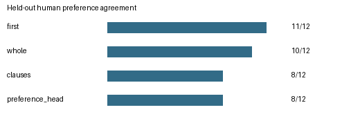
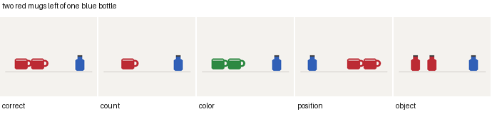

# Text-to-image preference reranking



On 12 held-out human decisions, whole-prompt PickScore agreed on 10 pairs, while attribute averaging and the trained head each agreed on 8. The original data put the preferred image first in 11/12 pairs. Mirroring each pair makes the always-first control 50% (12/24 presentations); the scorer decisions follow the same underlying images. The experiment does not establish an improvement over whole-prompt ranking. [Original-order outcomes](results/summary.csv) · [Position-balanced results](results/order-balanced.csv)

In the 36 natural prompts, 29 used the open-text fallback and 7 matched an object in the small vocabulary, including one with a matched color phrase. A separate known-answer probe renders controlled mugs and bottles from four prompts. Its five candidates differ in count, color, relative position or object identity. Whole-prompt scoring ranked the correct image first for 3/4 prompts, attribute averaging for 1/4 and the learned head for 0/4. These four constructed prompts are evaluated against their scene definitions, separately from human votes. [Per-prompt predictions](results/probe-predictions.json)



This project compares four ways of choosing between two generated images for a given prompt: always picking the first image, whole-prompt cosine, the mean score over extracted object, quantity, color and spatial conditions, and a preference head trained on the frozen scores. Human votes from Pick-a-Pic are the target. See `HANDOFF.md` for the latest verification status.

## Run

```shell
python -m pip install -r requirements.txt
python -m unittest discover -s tests
python run.py reproduce --device cpu
python run.py evaluate
```

`reproduce` downloads the pinned 3.95 GB PickScore checkpoint and a 36-prompt public preference subset, extracts real image/text embeddings, trains a four-feature pairwise logistic head, reloads it and evaluates the 12 held-out human decisions. Use `--cache` to share the model/data across repos and `--out` for a fresh output directory. When a slow connection interrupts the weights download, `python tools/range_model.py .cache/PickScore` resumes the large tensor file in independently cached ranges. `demo` refits the head from the shipped anonymized feature records once a full extraction has been recorded.

## Experiment

The training set uses 24 unique records from `validation_unique`, and the held-out set uses 12 records from `test_unique`. Both come from the public anonymous Pick-a-Pic v1 release, whose original training split is excluded from this experiment. Sampling removes ties, duplicate captions and reused candidate IDs across both arms. Image bytes remain in the local cache. The data manifest contains ranking IDs, split assignments, prompts and checksums, with user identities omitted.

`src/scoring.py` reuses the normalized frozen image and text similarity from PickScore. New code extracts object, quantity, color and spatial requirements with a fixed English vocabulary. Open-ended prompts outside that vocabulary are split into clauses. Whole-prompt cosine and the mean, minimum and standard deviation of individual condition scores are recorded; the conditions are text heuristics, without an object detector. Each query has two candidates and one human preference. Per-object counting, exact spatial localization and a general preference win rate need separate evidence.

The fitted linear weights are distributed under [their own MIT license](results/head.LICENSE) and are used by [Diffusion RL Reward Analysis](https://github.com/zzXavier/diffusion-rl-reward-analysis). The formal run writes a reusable head, held-out decisions, summary CSV and comparison plot into `results/`. `evaluate` reconstructs the summary and figure from the saved decisions.

A clean clone of commit 915804b independently recomputed all 36 human preference pairs and 20 controlled candidates from the pinned inputs. Nine artifacts, including the fitted head, the three tables and both figures, matched byte-for-byte. [Verification record](results/clean-clone-verification.json).
